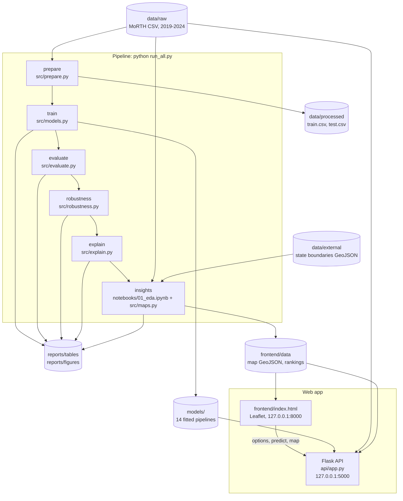

# CrashLens

**An interpretable, imbalance-aware machine learning framework for road accident severity on Indian roads.**

## Overview

CrashLens asks how deadly road accidents are across India's States and Union Territories, and which conditions and places make them deadlier. It works from the official yearly statistics of the Ministry of Road Transport and Highways (MoRTH) for 2019 to 2024.

The project has four parts:

1. **Modelling.** Classify each State × condition × year as Low, Medium or High severity, comparing simple, interpretable classifiers under three ways of handling class imbalance.
2. **Evaluation.** Score the models with metrics that respect class imbalance, test them for statistical differences, and check how much the results depend on the split and on leakage.
3. **Explanation.** Permutation importance, readable decision rules and SHAP values.
4. **Web app.** A Flask API and a single-page frontend with a risk check, a map of India and an insights tab.

## Architecture



`src/data.py` (loading, seed, leakage list) and `src/features.py` (features, time split, encoders) are shared by every phase. `explain_one()` in `src/explain.py` is what the API calls for each prediction.

## Dataset

- **File:** `data/raw/india_road_accidents_2019_2024.csv`, 11,752 rows and 17 columns.
- **Source:** compiled from the annual MoRTH publication *Road Accidents in India* (Transport Research Wing, Ministry of Road Transport and Highways, Government of India), editions 2019 to 2024, published at <https://morth.nic.in/road-accident-in-india>. The figures come from the State and UT annexure tables.
- **Unit of analysis:** one row is one State/UT, one category and one year. Every value is an aggregate count. There are no individual crash records.
- **Factor groups (9):** collision type, road environment, road feature, junction type, traffic control, weather, impacting vehicle, traffic violation and area type. Each group is a separate breakdown of the same accidents, so totals are taken from one group (collision type) and never added across groups.
- **Severity index:** persons killed per 100 accidents.
- **Target:** `severity_level`. Low is below 0.75 times the national severity index for that year, High is above 1.25 times, Medium lies between.
- **Rows used for modelling:** 9,332. The 2,420 rows with fewer than 10 accidents (`low_count_flag`) have no stable ratio and are dropped. The classes are High 3,616, Medium 2,865 and Low 2,851.

### Modelling rules

- **Features:** `factor_group`, `factor_value`, `region`, `state_type`, `state_harmonised`, `year` and log(1 + `accidents`).
- **Never features:** `killed`, `severity_index`, `national_severity`, `grievously_injured`, `minor_injured` and `total_injured`. They define the target.
- **Main split, by time:** train on 2019 to 2022 (6,327 rows), test on 2023 to 2024 (3,005 rows).
- **Second split, by state:** GroupKFold on `state_harmonised`, so no state is in both train and test.
- **Models:** Decision Tree, AdaBoost, K-Nearest Neighbours and Categorical Naive Bayes, with Random Forest as a reference.
- **Imbalance strategies:** none, class weights and SMOTEN, applied inside the pipeline so resampling only ever sees training folds.
- **Metrics:** macro-F1, balanced accuracy and per-class recall, with emphasis on the High class. Accuracy is secondary.

## Setup

Requires Python 3.11.

Windows (PowerShell):

```powershell
python -m venv .venv
.\.venv\Scripts\Activate.ps1
python -m pip install --upgrade pip
pip install -r requirements.txt
```

macOS or Linux:

```bash
python3.11 -m venv .venv
source .venv/bin/activate
python -m pip install --upgrade pip
pip install -r requirements.txt
```

Then place `india_road_accidents_2019_2024.csv` in `data/raw/`. The state boundaries are already in `data/external/india_states/`.

## Run the pipeline

Everything, in order (about 25 minutes on a laptop):

```bash
python run_all.py
```

Useful options: `--from evaluate` runs that phase and the ones after it, `--only explain insights` runs just those, and `--list` shows the phases. After a full run, the script checks that every generated file was rewritten and lists any that was not.

Each phase can also be run on its own from the project root:

| Phase | Command | What it does | Main outputs |
|---|---|---|---|
| prepare | `python -m src.prepare` | Checks the raw CSV, builds the features, writes the time split | `data/processed/train.csv`, `test.csv`, `split_summary.csv` |
| train | `python -m src.models` | Grid search with GroupKFold(5) by state for every model and strategy | `models/*.joblib`, `reports/tables/cv_results.csv` |
| evaluate | `python -m src.evaluate` | Test-set metrics and baseline, confusion matrices, repeated grouped CV, Friedman and Nemenyi tests | `test_results.csv/.tex`, `friedman_*.csv`, `nemenyi_p_values.csv`, `fig07`, `fig08` |
| robustness | `python -m src.robustness` | Split design, leakage and drift checks on the Decision Tree | `robustness.csv/.tex` |
| explain | `python -m src.explain` | Permutation importance, shallow-tree rules, SHAP summary | `permutation_importance.csv`, `shallow_tree_rules.*`, `fig09`, `fig10` |
| insights | `jupyter nbconvert --to notebook --execute --inplace notebooks/01_eda.ipynb`, then `python -m src.maps`, then `python -m src.paper_figures` | EDA figures, state map, region heatmap, deadliest conditions, Karnataka profile, frontend data, column-width charts for the paper | `fig01` to `fig06`, `fig11` to `fig17`, `deadliest_conditions.*`, `frontend/data/*` |

Tables are written to `reports/tables` and figures to `reports/figures` (PNG at 300 dpi and PDF).

`python -m src.models --model dt --strategy smoten` tunes one combination, and `python -m src.evaluate --skip-cv` skips the repeated cross-validation.

### Reproducibility

The seed is 42 everywhere. Every estimator, resampler, shuffled splitter, permutation and sample takes it explicitly, each script also seeds Python's and NumPy's global generators, and `run_all.py` fixes `PYTHONHASHSEED`. Rerunning the pipeline reproduces the tables exactly, except the fit-time column of `cv_results.csv`, which is a stopwatch reading.

## Run the web app

From the project root, with the virtual environment active, start the API in one terminal and the page in another:

```bash
python -m api.app                                               # API on http://127.0.0.1:5000
python -m http.server 8000 --bind 127.0.0.1 --directory frontend   # page on http://127.0.0.1:8000
```

Open <http://127.0.0.1:8000>. The models must exist first (`python run_all.py`, or at least the train phase).

| Endpoint | Purpose |
|---|---|
| `GET /health` | Liveness check and the name of the loaded model |
| `GET /api/options` | Valid states, regions, factor groups, values per group and years |
| `POST /api/predict` | Body: `state`, `factor_group`, `factor_value`, optional `year`. Returns the severity level, class probabilities, the top three factors and the yearly history |
| `GET /api/map` | State shapes with severity for every year (GeoJSON) |

The API listens on 127.0.0.1 only and accepts browser requests only from `http://127.0.0.1:8000` and `http://localhost:8000`. Set `CRASHLENS_FRONTEND_ORIGINS` (comma-separated) to change that. The page loads Leaflet from a CDN, so it needs internet access.

## Tests

```bash
python -m pytest
```

75 tests cover the feature rules and leakage guard, the pipeline structure for every model and strategy, and the API (endpoints, input validation, CORS and one call through the real model).

## Results summary

All numbers are regenerated by `python run_all.py`; the full tables are in `reports/tables`.

**Test set, 2023 to 2024 (3,005 rows), best strategy per model**

| Model | Strategy | Macro-F1 | Balanced accuracy | High recall | ROC-AUC |
|---|---|---|---|---|---|
| Majority-class baseline | always High | 0.191 | 0.333 | 1.000 | 0.500 |
| Random Forest (reference) | class weights | 0.778 | 0.781 | 0.792 | 0.920 |
| KNN | none | 0.744 | 0.746 | 0.828 | 0.886 |
| Decision Tree | class weights | 0.733 | 0.734 | 0.748 | 0.874 |
| AdaBoost | SMOTEN | 0.719 | 0.720 | 0.723 | 0.869 |
| Categorical Naive Bayes | SMOTEN | 0.708 | 0.711 | 0.776 | 0.875 |

- Every model is far above the baseline, and the models sit close together (macro-F1 0.69 to 0.78 across all 14 pipelines).
- The imbalance strategy changes macro-F1 by at most about 0.05 within a model. The classes are only mildly imbalanced, and High is the largest class.

**Unseen states: repeated grouped cross-validation (5 folds × 2 repeats, 2019 to 2022)**

| Model (best configuration) | Mean macro-F1 | Average rank |
|---|---|---|
| Random Forest, class weights | 0.454 | 2.0 |
| KNN, SMOTEN | 0.447 | 2.3 |
| Categorical Naive Bayes, class weights | 0.425 | 2.9 |
| Decision Tree, SMOTEN | 0.397 | 3.6 |
| AdaBoost, none | 0.380 | 4.2 |

- Friedman test: χ²(4) = 13.2, p = 0.010. The only pair that differs in the Nemenyi test at 0.05 is Random Forest against AdaBoost (p = 0.016).
- Scores drop from about 0.75 to about 0.45 when whole states are held out. The models predict well for states they have seen and poorly for states they have not.

**Robustness (Decision Tree)**

- A random row split scores 0.750 macro-F1 where a split by state scores 0.410: an inflation of 0.34 from having the same state on both sides.
- Adding `severity_index` as a feature lifts test macro-F1 from 0.711 to 0.981, and adding `killed` lifts it to 0.844. The leakage rule is necessary.
- Performance drifts only slightly: 0.721 on 2023 and 0.701 on 2024.

**Explanations**

- State carries almost all of the signal: shuffling it costs the Naive Bayes model 0.307 macro-F1, against 0.018 for the factor value.
- A depth-4 tree splits only on geography: outside the South it predicts High, inside the South mostly Low.
- SHAP on the Random Forest ranks state, region and State/UT status ahead of any crash condition.

**Descriptive findings (dataset only)**

- National severity rose from 33.7 deaths per 100 accidents in 2019 to 36.3 in 2024.
- In 2024, Bihar (80.5), Jharkhand (79.2) and Punjab (78.5) were the deadliest large states; Kerala (7.9) and Goa (10.7) the least.
- The deadliest conditions over six years are hail or sleet (46.2), run-off-road (46.1), vehicle overturn (45.8) and hit-and-run (45.3) crashes, against 36.0 overall.
- Karnataka is below the national figure in every year (28.8 against 36.3 in 2024) and in almost every condition.

## Limitations

- **Aggregate data, not individual crashes.** Each row is a yearly total for a State and a category. The models classify categories of accidents in a state; they say nothing about the risk of a single crash, driver or journey, and relationships seen in the totals need not hold for individual crashes.
- **Severity is a ratio of reported counts.** Deaths per 100 accidents rises when minor accidents go unreported, so differences between states partly reflect reporting practice. Rows with fewer than 10 accidents are excluded, and states with a few hundred accidents a year still have unstable ratios.
- **Categories change across years.** `junction_type` and `traffic_control` stop reporting their "Others" category from 2022, so those groups cover only about 20 to 23% of accidents afterwards. `road_environment` has three categories in 2024 and covers 41%. Comparisons across years for these groups need care.
- **Administrative units change across years.** Dadra & Nagar Haveli and Daman & Diu are reported separately in 2019 and merged from 2020; Ladakh is reported separately from Jammu & Kashmir from 2021. `state_harmonised` merges these into 35 consistent units, so 115 modelling rows share a state, year and category with another row.
- **Two small inconsistencies in MoRTH's 2020 tables.** Within a state and year, every factor group should add up to the same totals. Two do not, both for persons killed in 2020: Meghalaya's impacting-vehicle table sums to 6 more deaths than its other tables, and Tamil Nadu's road-feature table to 1 more. The values are kept as published. The effect on any result is negligible.
- **The models mostly learn geography.** Scores on the time split are high because the same states appear in training and test. For a state not seen in training, macro-F1 is about 0.45.
- **Short history.** Six years, two of them test years, one of the training years disrupted by COVID-19. The drift check rests on two points.
- **Significance tests are approximate.** The ten cross-validation folds reuse the same data and the hyperparameters were tuned on the same years.

## Known fragile points

- **Random Forest serves the app.** The API and the SHAP figures use the best pipeline by tuning score, which is the reference model, not one of the four interpretable ones.
- **Slow explanations.** The forest's trees are very deep, so each prediction with its explanation takes about 2 seconds, and the SHAP figure uses 500 sampled test rows.
- **Development server.** `python -m api.app` runs Flask's built-in single-process server. It is meant for local use only.
- **Predictions need an accident count.** The API takes it from the dataset for the requested year, or the latest earlier year. A state and category with no reported accidents cannot be predicted.
- **State boundaries.** The GeoJSON is a public file whose licence and depiction of external boundaries have not been verified (see `data/external/india_states/SOURCE.txt`). The pipeline does not download it; it must be present.
- **Hard-coded names.** Four boundary names are mapped by hand to `state_harmonised`, and two map labels are nudged by hand. A renamed state stops the insights phase with an error.
- **Saved models are tied to library versions.** The `.joblib` files load only with the pinned scikit-learn and imbalanced-learn versions. Retrain after any upgrade.
- **External assets.** Leaflet comes from a CDN with integrity hashes; offline, the map tab shows an error message.
- **Fixed addresses.** The API port (5000), the frontend port (8000) and the allowed origins are fixed defaults.
- **Untested areas.** There are no automated tests for the evaluation, robustness, explanation and map scripts, or for the frontend. The frontend was checked by screenshots down to 520 px wide; popups and year buttons were not exercised automatically.
- **Notebook execution.** The insights phase runs the EDA notebook through `nbconvert`, which needs a working Jupyter kernel in the virtual environment and rewrites the notebook in place.

## Project structure

```
run_all.py         Runs every phase in order
data/raw/          Raw MoRTH CSV
data/external/     State boundaries (GeoJSON)
data/processed/    Train and test split (generated)
notebooks/         01_eda.ipynb, exploratory analysis
src/               data, features, prepare, models, evaluate, robustness, explain, maps
api/               Flask API (app.py)
frontend/          index.html, plus generated data/ and img/
reports/figures/   Figures for the paper (generated)
reports/tables/    Result tables for the paper (generated)
models/            Fitted pipelines (generated)
tests/             Unit and API tests
```
